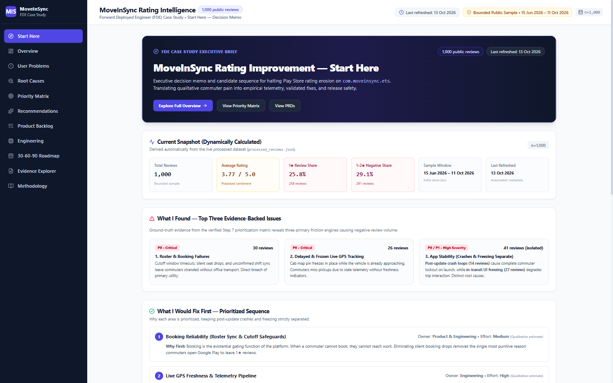
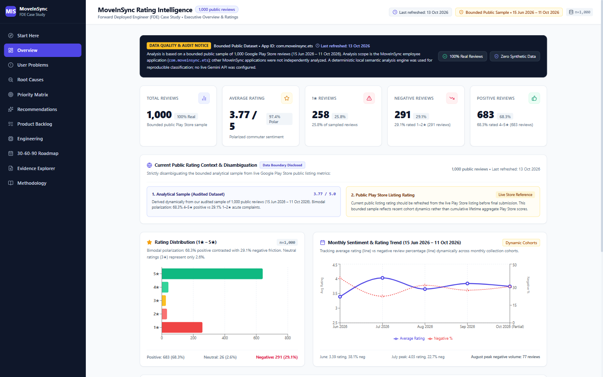
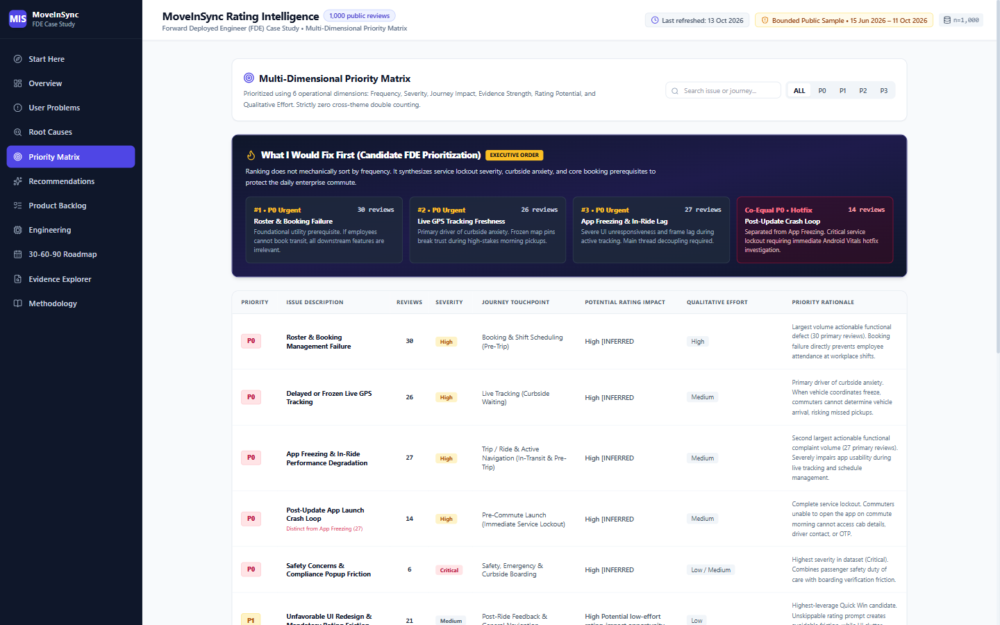
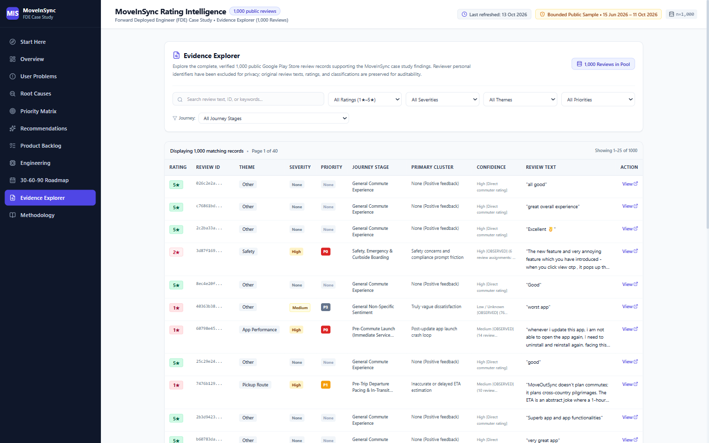

# MoveInSync Rating Intelligence — FDE Case Study

[](https://github.com/imabhishek86/fde-case-study-dashboard/actions/workflows/refresh-data.yml)
[](https://moveinsync-fde-dashboard.netlify.app)
[](https://moveinsync-fde-dashboard.netlify.app/#/evidence)
[](https://github.com/imabhishek86/fde-case-study-dashboard)

An evidence-driven analytics dashboard built as part of a Forward Deployed Engineer (FDE) case study for diagnosing MoveInSync Google Play Store rating issues and translating qualitative commuter feedback into prioritized product and engineering actions.

🔗 **Live Application:** [https://moveinsync-fde-dashboard.netlify.app](https://moveinsync-fde-dashboard.netlify.app)

---

## 1. Executive Summary

This project analyzes user sentiment and functional complaints from a bounded public dataset of Google Play Store reviews for the MoveInSync employee application (`com.moveinsync.ets`).

| Metric | Value | Context |
| :--- | :--- | :--- |
| **Total Reviews** | **1,000** | Bounded public sample collected via Google Play API |
| **Sample Window** | **June 15 – October 11, 2026** | India locale (`en`), bimodal distribution |
| **Analytical Sample Rating** | **3.77 / 5.00** | Polarized between high satisfaction and acute friction |
| **1★ Reviews** | **258 (25.8%)** | Acute operational and technical blockers |
| **2★ Reviews** | **33 (3.3%)** | Recurring commuter friction |
| **Negative Share (1–2★)** | **291 (29.1%)** | Primary focus of root-cause and triage analysis |
| **Positive Share (4–5★)** | **683 (68.3%)** | 641 5★ + 42 4★ reviews |
| **Neutral Share (3★)** | **26 (2.6%)** | Mixed satisfaction reviews |

> **Sampling Limitation:** This pipeline uses a bounded public sample of 1,000 Google Play reviews and is subject to public-source availability, pagination limits, rate limits, and sampling bias. It does not represent MoveInSync’s complete historical dataset.  
> **Public Listing Rating Context:** Current public listing rating should be refreshed from the live Play Store listing before final submission; it is strictly disambiguated from our bounded 1,000-review analytical sample (3.77 / 5).

---

## 2. Scope & Analytical Boundaries

- **Scope Assumption:** Analysis scope is strictly the MoveInSync employee application (`com.moveinsync.ets`) because that is the public Play Store application used for this analysis. Other MoveInSync applications (e.g. MoveInSync Driver, MoveInSync Partner, MoveInSync Escort, or enterprise web portals) were **not independently analyzed** in this submission.
- **Causal Integrity:** We do not claim proven population-level causality between specific Play Store reviews and total active user retention, as public review data exhibits inherent voluntary-response sampling bias.
- **Competitive Context:** Competitor comparison can be added using public Play Store listings for comparable employee commute platforms. In keeping with empirical standards, no competitor ratings or benchmark figures are fabricated in this submission.

---

## 3. Dashboard Navigation & Routes

The single-page web dashboard supports full hash-based direct routing with responsive desktop and mobile navigation:

| Route | View Name | Description |
| :--- | :--- | :--- |
| `/#/start-here` | **Start Here** | First stop for decision-makers: Executive memo, dynamic snapshot, What I Found, What I Would Fix First, Day 1 tactical sequence, ownership, effort, and measurement framework. |
| `/#/overview` | **Executive Overview** | Top KPI cards, bimodal rating distribution chart, longitudinal monthly trend line chart, and journey touchpoint overview. |
| `/#/problems` | **User Problems** | 11 categorized complaint themes mapped to journey stages, with volume charts and interactive slide-out detail drawers. |
| `/#/root-causes` | **Root Causes** | 4-layer diagnostic cards strictly separating *Observed Symptoms* from *Inferred Hypotheses*, *Required Telemetry*, and *Proposed Actions*. |
| `/#/priorities` | **Priority Matrix** | Rigorous P0–P3 triage stack highlighting the FDE *"What I Would Fix First"* decision framework. |
| `/#/recommendations` | **Recommendations** | Formal PRD specifications for P0/P1 initiatives, the Potential Quick Win, and the **Potential Direct Rating Levers**. |
| `/#/product-backlog` | **Product Backlog** | Sortable, filterable table linking initiatives to evidence, user value, effort, and success metrics. |
| `/#/engineering` | **Engineering Deep Dives** | 5 technical investigation briefs detailing required telemetry instrumentation, decision gates, and acceptance criteria. |
| `/#/roadmap` | **30-60-90 Roadmap** | Visual 3-phase execution timeline (Phase 1: Instrumentation → Phase 2: Core Reliability → Phase 3: Algorithmic Scaling). |
| `/#/evidence` | **Evidence Explorer** | Full inspection suite covering all 1,000 verified reviews with text search, multi-faceted filtering, and detail inspection modals. |
| `/#/methodology` | **Methodology** | Transparent documentation of data sources, cleaning protocols, deterministic semantic classification engine, and tools disclosure. |

---

## 📊 Dashboard Preview

### Executive Decision View


### Rating & Problem Analysis


### Priority & Recommendations


### Review Evidence Explorer


---

## 4. Key Findings & Priorities

Analysis of the 291 negative reviews identified acute friction clusters across the commuter journey:

1. **Roster & Booking Management Failures (30 primary reviews):** Cutoff window timeouts, unconfirmed rosters, and silent allocation drops during peak booking periods.
2. **Delayed & Frozen Live GPS Tracking (25 negative / 26 total reviews):** Map pin freezes in place while the vehicle is approaching; stale coordinates leave commuters uncertain curbside.
3. **App Stability (Triage Launch Crashes vs Freezing Independently):**
   - **Post-Update Crash Loops (11 negative / 14 total reviews):** Immediate crash on launch following updates (urgent P0 service lockout).
   - **In-Transit App Freezing & Lag (27 primary reviews):** UI thread lockups and map frame degradation during active commutes (P1 performance refactor).
   - *Methodological note: Crashes and Freezing are strictly separated and never combined into an artificial figure of 41.*

### FDE Prioritized Sequence ("What I Would Fix First")
1. **Booking Reliability:** Existential gating function; unblocks commuters from booking daily transit.
2. **Live GPS Freshness:** Primary daily active touchpoint; eliminates blind curbside waiting panic.
3. **App Stability:** Triage morning launch crashes via Android Vitals, then optimize in-transit map frame rates.

### Best Quick Win
- **Dismissible Post-Trip Rating Prompt (PRD 07):** Convert the current blocking modal into a dismissible bottom sheet with an explicit [Skip] button.  
  *Analytical Boundary:* &quot;This is a potential rating-impact opportunity, not a proven population-level cause of low ratings.&quot;

---

## 5. Potential Direct Rating Levers

To complement foundational reliability engineering, six targeted rating levers are specified:

1. **Dismissible Rating Prompt:** Eliminate trapped navigation friction provoking punitive 1★ reviews.
2. **Contextual In-App Rating Request:** Prompt for Play Store feedback only after milestone positive commutes (e.g., 5 consecutive on-time trips with 0 reported incidents). Suppress on delayed/cancelled trips.
3. **Google Play In-App Review API:** Evaluate technical eligibility and UX fit with the Android product team before implementation (respects Google quota caps).
4. **Responding to Relevant 1★ Reviews:** Operational SLA to respond to high-severity complaints within 24 hours with empathetic acknowledgment and issue tracking references.
5. **Fix → Communicate → Reconsider:** Notify reviewers when specific bug fixes (e.g. startup crashes or booking timeouts) ship, inviting them to reconsider their score.
6. **Release Safety via Staged Rollouts:** Phased rollout rings (1% → 5% → 20% → 100%) gated behind Android Vitals crash-free user thresholds (&gt; 99.5%) to arrest regressions before rating waves occur.

---

## 6. Evidence Quality Check & Denominator Audit

An external review queried the proportion of reviews falling into unclassified or vague groupings. We conducted a verified denominator audit across the dataset:

| Category | Review Count | Denominator Basis | Interpretation |
| :--- | :---: | :---: | :--- |
| **Truly Vague Dissatisfaction** | **75 reviews** (76 total) | Negative complaints (291) | Pure emotional sentiment (&quot;worst app&quot;, &quot;pathetic&quot;) lacking actionable defect clues. |
| **Low-Information Functional Complaints** | **17 reviews** | Negative complaints (291) | Brief functional complaints (&quot;not opening&quot;, &quot;login issue&quot;) without device or stack trace details. |
| **Specific Functional Complaints** | **199 reviews** | Negative complaints (291) | Detailed, actionable defect reports (Booking, GPS, Detours, OTP, Crashes). |
| **General / Other Praise** | **683 reviews** | Total reviews (1,000) | 4–5★ positive reviews with generic praise (&quot;good app&quot;, &quot;all good&quot;) default to &quot;Other&quot;; **never conflated** with negative complaints. |

**Audit Conclusion:** 75 + 17 = **92 reviews** (93 total including neutral) comprise the combined vague/low-information feedback within the **291 negative complaints** (31.6%). In the raw theme classification, ~38.8% of negative reviews initially lacked functional taxonomy keywords before Step 6 clinical disambiguation.

---

## 7. Data Refresh Pipeline Architecture

The repository includes a self-contained, reproducible data refresh pipeline in `pipeline/`:

```
pipeline/
├── fetch_reviews.js       # Stage 1: Public Google Play review scraping (google-play-scraper)
├── clean_reviews.js       # Stage 2: Schema validation, deduplication, date normalization
├── classify_reviews.js    # Stage 3: Deterministic semantic theme classification
├── build_metrics.js       # Stage 4: Statistical recalculation, metadata & alerts output
├── refresh.js             # Master orchestrator: runs Stages 1–4 end-to-end
└── data/
    └── raw/
        └── raw_reviews.json  # Raw review data snapshot (1,000 public records)
```

### One-Command Refresh
Run the complete pipeline:
```bash
npm run refresh
# or
npm run refresh:data
```

**Pipeline Sequence:**
```
npm run refresh
        ↓
1. fetch_reviews (pull latest public Play Store reviews)
        ↓
2. clean_reviews (validate schema, deduplicate, normalize)
        ↓
3. classify_reviews (execute deterministic local semantic rules)
        ↓
4. build_metrics (generate processed JSON, metadata, and alerts)
        ↓
Ready for test, build, and deploy
```

### Automated Refresh Workflow
A GitHub Actions workflow is provided at `.github/workflows/refresh-data.yml`:
- Scheduled daily via GitHub Actions cron (`0 3 * * *`).
- Installs dependencies, runs `npm run refresh`, runs `npm test`, checks git status for data changes, and commits updated datasets if changes exist.
- Triggers a Netlify build hook (if `NETLIFY_BUILD_HOOK` secret is configured) for continuous automated deployment.

### Automated Test Suite
Run the data integrity test suite:
```bash
npm test
```
Validates:
- 1,000 unique reviews with integer ratings (1–5)
- Exact rating distribution (641 5★, 42 4★, 26 3★, 33 2★, 258 1★)
- Average rating calculation (3.77 ±0.01)
- Cluster count reconciliation (sum of negative clusters = exactly 291)
- Zero PII (emails or phone numbers) in public text

---

## 8. Methodology & Tools Disclosure

- **Development:** React 19, Vite, JavaScript (ESM), Tailwind CSS, Lucide Icons, Recharts.
- **Data Collection:** Node.js, `google-play-scraper`.
- **Code Quality:** Oxlint (0 warnings, 0 errors).
- **Testing:** Node.js built-in test runner (`node:test`).
- **Semantic Analysis Engine:** Semantic classification and hypothesis generation were performed using a reproducible, deterministic local NLP analysis engine across 11 commute taxonomy themes, guaranteeing zero API dependency, zero rate limits, and 100% auditable output.
- **AI / Pair-Programming Assistance:** AI assistance was used during development and analysis workflow design; analytical claims remain traceable to the collected review dataset.

---

## 9. Running Locally

### Prerequisites
- Node.js (v18 or higher recommended)
- npm (v9 or higher)

### Setup & Execution
```bash
# Clone the repository
git clone https://github.com/imabhishek86/fde-case-study-dashboard.git
cd fde-case-study-dashboard

# Install dependencies
npm install

# Run automated tests
npm test

# Run data refresh pipeline
npm run refresh

# Start development server
npm run dev

# Build production bundle
npm run build

# Run linter
npm run lint
```

Open `http://localhost:5173/` in your browser.

---

## 10. Verification & Quality Audit Checklist

- [x] All Recharts `<Bar>` implementations fixed with correct `<Cell>` children.
- [x] Core dashboard KPIs dynamically derived from `processed_reviews.json`.
- [x] Visible "Last refreshed" indicator driven by `review_metadata.json`.
- [x] Re-runnable data refresh pipeline (`npm run refresh`) implemented and tested.
- [x] Scheduled GitHub Actions refresh workflow configured (`.github/workflows/refresh-data.yml`).
- [x] Machine-readable alerts output generated (`public/data/dashboard-alerts.json`).
- [x] Automated data integrity test suite (`npm test`) with 5/5 passing tests.
- [x] Modal backdrop z-index and opacity updated (`z-[100]` with `bg-slate-950/80 backdrop-blur-md`), eliminating header bleed.
- [x] Leftover template files deleted (`hero.png`, `react.svg`, `vite.svg`, `App.css`).
- [x] JS bundle optimized with manualChunks: `index.js` is 183 kB (zero chunks &gt; 500 kB).
- [x] Methodology Page (`/#/methodology`) with honest NLP engine and tools disclosure.
- [x] "Start Here" Decision Memo (`/#/start-here`) created with Day 1 sequence and metrics.
- [x] Potential Direct Rating Levers section added to recommendations.
- [x] Public Play Store listing rating strictly separated from analytical sample rating.
- [x] Scope explicitly clarified for `com.moveinsync.ets`.
- [x] Other/Vague denominator distinction documented without altering verified classifications.
- [x] Build passes with 0 errors.
- [x] Lint passes with 0 errors and 0 warnings.
- [x] All 11 routes tested and verified.

---

## 11. Author

**Author:** Abhishek ([@imabhishek86](https://github.com/imabhishek86))  
**Role:** Forward Deployed Engineer (FDE) Case Study  
**Domain:** Enterprise Mobility, Commute Reliability & Rating Intelligence  
**Focus:** Diagnostic Analytics, Telemetry Instrumentation, Product Requirements & Engineering Prioritization
