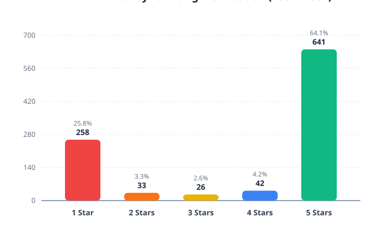
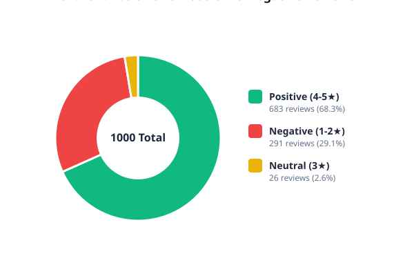
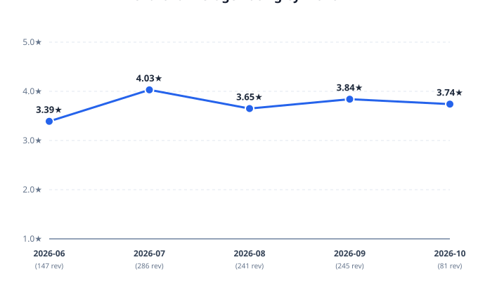
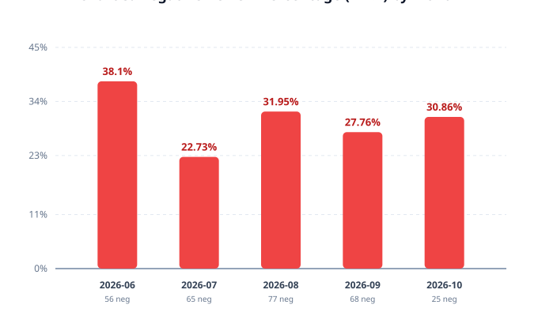

# MoveInSync Rating Analysis

## Dataset
- **Number of Reviews:** 1000
- **Date Range:** 2026-06-15 to 2026-10-11
- **Source / Sample Description:** Bounded public Google Play Store sample collected from the official package `com.moveinsync.ets` (India store, English locale). The dataset was deduplicated, cleaned, and verified with zero missing fields in Step 2.

## Overall Rating
- **Average Rating:** 3.77 / 5.00
- **Rating Distribution:**
  - **5 Stars:** 641 reviews (64.1%)
  - **4 Stars:** 42 reviews (4.2%)
  - **3 Stars:** 26 reviews (2.6%)
  - **2 Stars:** 33 reviews (3.3%)
  - **1 Star:** 258 reviews (25.8%)

## Positive/Neutral/Negative Distribution
- **Positive Reviews (4–5 Stars):** 683 reviews (68.3%)
- **Neutral Reviews (3 Stars):** 26 reviews (2.6%)
- **Negative Reviews (1–2 Stars):** 291 reviews (29.1%)

## Monthly Trends

| Month | Total Reviews | Avg Rating | 1★ | 2★ | 3★ | 4★ | 5★ | Negative (1-2★) % |
| :--- | :---: | :---: | :---: | :---: | :---: | :---: | :---: | :---: |
| **2026-06** | 147 | 3.39★ | 51 | 5 | 6 | 5 | 80 | **38.1%** |
| **2026-07** | 286 | 4.03★ | 54 | 11 | 6 | 16 | 199 | **22.73%** |
| **2026-08** | 241 | 3.65★ | 69 | 8 | 9 | 8 | 147 | **31.95%** |
| **2026-09** | 245 | 3.84★ | 61 | 7 | 4 | 11 | 162 | **27.76%** |
| **2026-10** | 81 | 3.74★ | 23 | 2 | 1 | 2 | 53 | **30.86%** |

- **Month with Highest Average Rating:** **2026-07** (4.03★ across 286 reviews)
- **Month with Lowest Average Rating:** **2026-06** (3.39★ across 147 reviews)
- **Month with Highest Negative Volume:** **2026-08** (77 negative reviews out of 241)
- **Month with Highest Negative Percentage:** **2026-06** (**38.1%** negative reviews)

## Key Observations
1. **Bimodal Rating Pattern:** Ratings are strongly polarized between 5 stars (64.1%) and 1 star (25.8%). Middle ratings (2, 3, and 4 stars) together account for only 10.1% of all reviews.
2. **Substantial Negative Share:** 1-star reviews represent 25.8% of the analyzed sample, and total negative sentiment (1-2 stars) accounts for 29.1% (291 out of 1000 reviews).
3. **Monthly Rating Variation:** Monthly average ratings fluctuate between a low of 3.39★ in **2026-06** and a peak of 4.03★ in **2026-07**.
4. **Peak Negative Concentration:** The highest monthly proportion of negative feedback occurred in **2026-06**, where negative reviews represented **38.1%** of that month's sample volume.
5. **Low Neutral Volume:** Neutral (3-star) feedback constitutes only 2.6% (26 reviews), indicating users predominantly leave reviews during highly positive or highly negative experiences.
