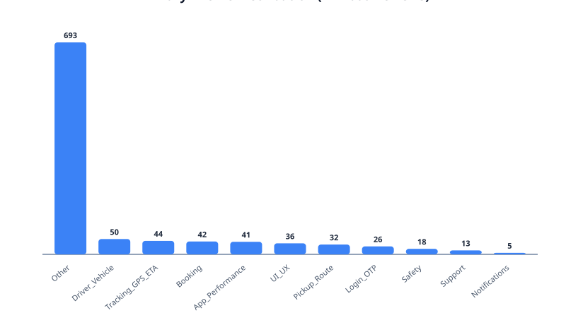
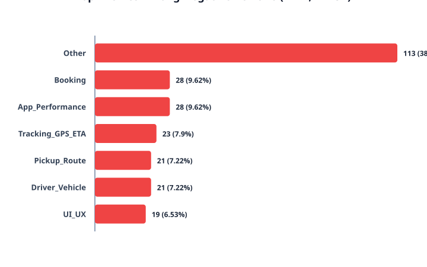
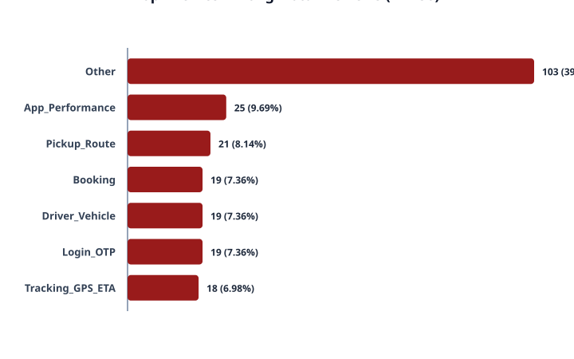
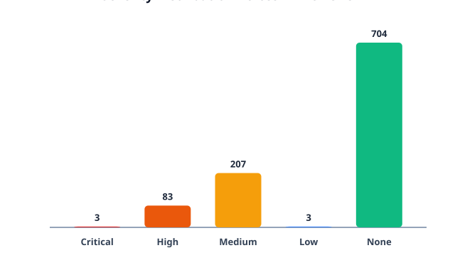

# MoveInSync Review Theme Analysis

## Methodology
The dataset of 1,000 verified public reviews from `data/processed/processed_reviews.json` was classified using a deterministic, rule-based semantic classification engine across an 11-theme taxonomy:
1. **Booking** (booking failures, slot availability, cancellation, roster issues)
2. **Tracking_GPS_ETA** (live tracking errors, inaccurate ETA, vehicle location mismatch)
3. **App_Performance** (crashes, freezing, black/blank screens, slow load, reinstall loops)
4. **UI_UX** (interface confusion, redesign dissatisfaction, extra clicks, popup annoyance)
5. **Pickup_Route** (routing algorithms, detour complaints, pickup/drop location errors)
6. **Driver_Vehicle** (driver conduct, driving style, vehicle condition, AC issues)
7. **Notifications** (missing/delayed push notifications, alert alarms)
8. **Login_OTP** (OTP delivery, session logout, authentication failures)
9. **Support** (customer service responsiveness, ticketing, grievance resolution)
10. **Safety** (seatbelt prompts, panic/SOS, night shift & women commuter concerns)
11. **Other** (general praise, short non-specific feedback, or unclassified items)

Each review was scored against contextual multi-word phrase patterns and intent dictionaries to assign:
- `primaryTheme`: Dominant subject of the review
- `secondaryThemes`: Additional co-occurring themes
- `sentiment`: `negative` (1–2★), `neutral` (3★), `positive` (4–5★)
- `severity`: `Critical`, `High`, `Medium`, `Low`, `None` (gauged by real-world operational user impact)
- `complaintFlag`: Boolean flag for reviews stating concrete functional problems

All original review texts were preserved unmodified.

## Overall Theme Distribution

| Theme | Total Occurrences | % of All Reviews (N=1000) | Positive (4-5★) | Neutral (3★) | Negative (1-2★) | High/Critical Severity |
| :--- | :---: | :---: | :---: | :---: | :---: | :---: |
| **Booking** | 42 | 4.2% | 12 | 2 | 28 | 21 |
| **Tracking_GPS_ETA** | 44 | 4.4% | 18 | 3 | 23 | 18 |
| **App_Performance** | 41 | 4.1% | 5 | 8 | 28 | 28 |
| **UI_UX** | 36 | 3.6% | 16 | 1 | 19 | 2 |
| **Pickup_Route** | 32 | 3.2% | 10 | 1 | 21 | 6 |
| **Driver_Vehicle** | 50 | 5% | 27 | 2 | 21 | 2 |
| **Notifications** | 5 | 0.5% | 1 | 0 | 4 | 0 |
| **Login_OTP** | 26 | 2.6% | 3 | 4 | 19 | 3 |
| **Support** | 13 | 1.3% | 1 | 0 | 12 | 3 |
| **Safety** | 18 | 1.8% | 15 | 0 | 3 | 3 |
| **Other** | 693 | 69.3% | 575 | 5 | 113 | 0 |

## Negative Review Themes (1-2★, N=291)

| Rank | Theme | Negative Count | % of Negative Reviews |
| :---: | :--- | :---: | :---: |
| 1 | **Other** | 113 | 38.83% |
| 2 | **Booking** | 28 | 9.62% |
| 3 | **App_Performance** | 28 | 9.62% |
| 4 | **Tracking_GPS_ETA** | 23 | 7.9% |
| 5 | **Pickup_Route** | 21 | 7.22% |
| 6 | **Driver_Vehicle** | 21 | 7.22% |
| 7 | **UI_UX** | 19 | 6.53% |
| 8 | **Login_OTP** | 19 | 6.53% |
| 9 | **Support** | 12 | 4.12% |
| 10 | **Notifications** | 4 | 1.37% |
| 11 | **Safety** | 3 | 1.03% |

## 1-Star Review Themes (N=258)

| Rank | Theme | 1-Star Count | % of 1-Star Reviews |
| :---: | :--- | :---: | :---: |
| 1 | **Other** | 103 | 39.92% |
| 2 | **App_Performance** | 25 | 9.69% |
| 3 | **Pickup_Route** | 21 | 8.14% |
| 4 | **Booking** | 19 | 7.36% |
| 5 | **Driver_Vehicle** | 19 | 7.36% |
| 6 | **Login_OTP** | 19 | 7.36% |
| 7 | **Tracking_GPS_ETA** | 18 | 6.98% |
| 8 | **UI_UX** | 17 | 6.59% |
| 9 | **Support** | 12 | 4.65% |
| 10 | **Notifications** | 4 | 1.55% |
| 11 | **Safety** | 1 | 0.39% |

## Severity Distribution

| Severity Level | Count | % of Total (N=1000) | Definition |
| :--- | :---: | :---: | :--- |
| **Critical** | 3 | 0.3% | Immediate safety, harassment, or medical threat |
| **High** | 83 | 8.3% | Blocked commute, app crash loop, booking failure, tracking outage |
| **Medium** | 207 | 20.7% | Usability frustration, inaccurate ETA, notification delay, detour |
| **Low** | 3 | 0.3% | Minor inconvenience, UI preference |
| **None** | 704 | 70.4% | Positive or non-complaint feedback |

## Multi-Theme Reviews
- **Multi-Theme Review Count:** 116 reviews (11.6% of total dataset).
- These reviews express overlapping issues (e.g., inaccurate ETA combined with circuitous routing, or app update crashes combined with login session drops).

## Key Observations
1. **Prominence of Operational Themes in Negative Reviews:** Among 291 negative reviews (1–2★), **Booking** is the most frequent specific functional complaint (28 reviews, 9.62%), followed by **App_Performance** (28 reviews, 9.62%) and **Tracking_GPS_ETA** (23 reviews, 7.9%).
2. **Generic Negative Sentiment:** 113 negative reviews (38.83%) contain short, general expressions of dissatisfaction (e.g., "worst app", "bekar app") without describing a specific functional defect.
3. **High-Impact Commuter Disruption:** A total of 83 reviews fall into the **High** severity category, representing severe friction points such as inability to open the app after updates, failure to secure booking for daily office transit, or tracking failure while waiting for cabs.
4. **Co-Occurrence Pattern:** 116 reviews span multiple themes, demonstrating that commute disruptions frequently compound (e.g., inaccurate live tracking paired with routing detours).
5. **Safety Concerns Detected:** Safety-related themes appear in 18 reviews, including 3 reviews classified with High or Critical severity.
